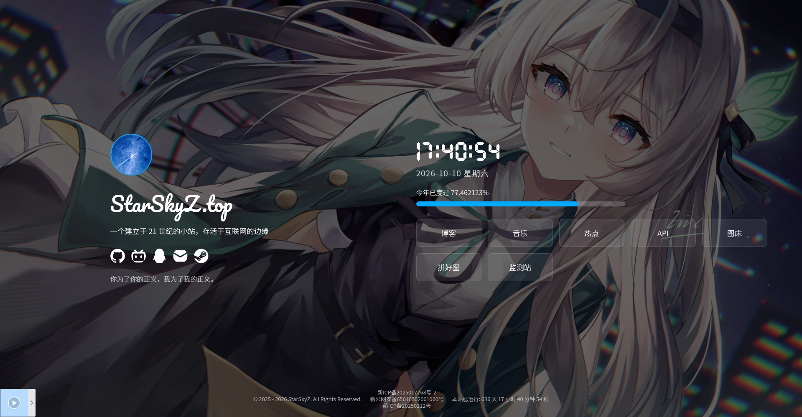

# StarSkyZの主页



这是我的个人主页 https://starskyz.top ，包含时钟、年度进度条、问候语、一言、社交链接、服务导航卡片，以及左下角 APlayer 音乐播放器。

## 功能

- 数字时钟（24 小时制）与日期星期显示
- 年度进度条（今年已度过百分比，精确到小数点后 6 位）
- 按时间段随机欢迎语（深夜 / 清晨 / 上午 / 下午 / 傍晚 / 夜晚）
- 一言（hitokoto）句子展示，鼠标悬停社交图标时切换为提示语
- 社交链接与导航卡片（JS 数据驱动渲染）
- 站点运行时间与版权年份自动计算
- APlayer + MetingJS 音乐播放器（网易云歌单，固定左下角）
- 移动端 / 桌面端双页脚与一键切换按钮
- 哀悼模式样式预留、右键菜单禁用

## 技术栈

- 原生 HTML / CSS / JavaScript
- [APlayer](https://github.com/DIYgod/APlayer) + [MetingJS](https://github.com/metowolf/MetingJS)（jsdelivr CDN）
- 歌单解析接口：`meting.api.redcha.cn`（MetingJS v2 模板格式）
- 一言接口：`v1.hitokoto.cn`

## 目录结构

```
index/
├── index.html          # 页面结构，含 <meting-js> 播放器标签
├── css/
│   └── style.css       # 全站样式
├── js/
│   └── script.js       # 时钟 / 进度条 / 导航渲染 / 问候语等逻辑
├── font/               # 本地字体
└── images/icon/        # 图标与 favicon
```

## 部署前需要填写的配置

本仓库为脱敏版本，以下几处上传部署前请自行替换：

1. **歌单 ID**：`index.html` 中 `<meting-js>` 标签的 `id="x"`，换成你的网易云歌单 ID
2. **备案号**：页脚两处 `<p class="icp">` 内的 `x`，换成你的 ICP / 公安备案号
3. **个人链接**：`js/script.js` 顶部的 `SOCIAL_LINKS_DATA`（社交链接）与 `NAV_LINKS_DATA`（导航卡片）
4. **背景图接口**：`css/style.css` 中 `body` 的 `background` 地址

## 本地预览

直接用浏览器打开 `index.html` 即可（部分 CDN 资源需要联网加载）。

## License

All Rights Reserved.
